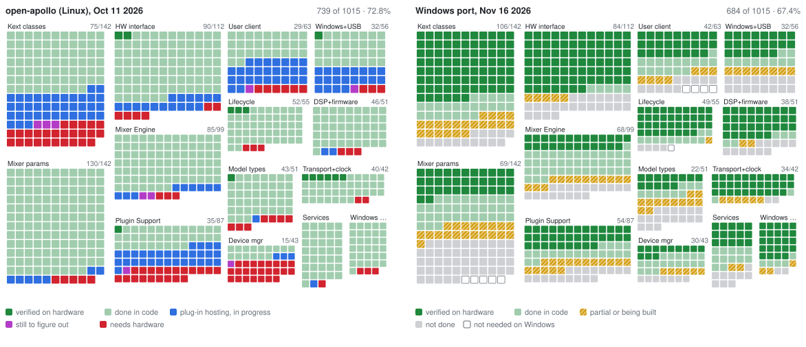

# open-apollo for Windows

**A Windows driver, ASIO driver and console app for Universal Audio Apollo Thunderbolt interfaces**, built on
[open-apollo](https://github.com/rolotrealanis98/open-apollo)'s reverse engineering of the Apollo hardware.

The port replaces UA's Windows driver on the unit. Windows gets every input and output pair as its own sound
device, DAWs get an ASIO driver (for one unit, or several units as one device), and Apollo Control gives you the
console: preamps, monitor mix, cues, aux buses, UAD plug-in inserts on the Apollo's own DSP, and sessions. It
ships no Universal Audio files: it reads what the Apollo needs from your own UAD install.

> **Experimental.** The driver is test-signed and has run on two units so far: an Apollo x8p and an Apollo Twin X,
> both Gen 1. Expect rough edges.

## Status

<picture>
  <source media="(prefers-color-scheme: dark)" srcset="windows/docs/status/progress-dark.svg">
  
</picture>

Each square is one behaviour of UA's own drivers, from open-apollo's parity map of 1,015. The left map is
open-apollo on Linux (Oct 11 2026), the right one this Windows port (Nov 15 2026). The Windows port started on
Nov 10 2026. The numbers per area, where the port is ahead of open-apollo and what is still open are in
[windows/docs/status](windows/docs/status/).

## What works on Windows

Proven on an x8p and a Twin X Gen 1:

- Both units brought up and running together, recovering from power cycles and driver updates
- Mic inputs that stay live through driver reloads and updates
- 23 Windows sound devices with no glitches over 30-minute runs (Zoom, Discord, browsers)
- ASIO for one unit, or both units as one 60 in / 56 out device with drift correction over Thunderbolt
- Preamps, monitor section, monitor mix and cues from the app
- UAD plug-ins running on the x8p's DSP (four have passed the live check so far)

The Twin X Gen 1 runs here although open-apollo lists it as unverified. More is built and waiting for a hardware
run: sample rates up to 192 kHz, speaker correction, four inserts per input, aux buses, clock sources, sessions.
See [windows/README.md](windows/README.md).

## Get started

Build and install instructions, the folder layout and the licences are in [windows/README.md](windows/README.md).
You need the Enterprise WDK to build and Windows test-signing mode to load the driver.

## This repository

| Path | What it is |
|---|---|
| [`windows/`](windows/) | The Windows port: kernel driver, ASIO driver, Apollo Control, tools, docs |
| everything else | open-apollo's Linux driver, mixer engine, console and docs, as upstream. Its README is [README.open-apollo.md](README.open-apollo.md) |

## Credits

The hardware knowledge this port stands on (bring-up, DSP rings, input strips, the mixer, plug-in mapping) comes
from open-apollo by [rolotrealanis98](https://github.com/rolotrealanis98) and its contributors. The Windows port
follows its GPL-2.0 licence; the ASIO driver is GPL-3.0 because of Steinberg's ASIO SDK.
