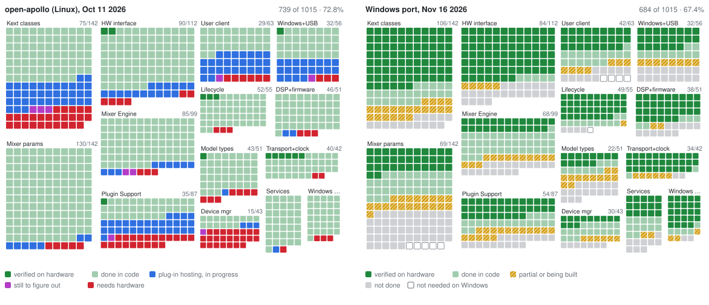

# open-apollo for Windows

A Windows driver stack for Universal Audio Apollo Thunderbolt interfaces, ported from open-apollo's Linux
driver and mixer engine. It replaces UA's Windows driver on the unit and gives Windows every channel as its own
sound device, an ASIO driver, and a console app.

Targets: **Apollo x8p (Gen 1)** and **Apollo Twin X (Gen 1)**, alone or together, on Windows 11 x64.

[](docs/status/)
[](docs/status/)
[](docs/status/)
[](docs/status/)

<picture>
  <source media="(prefers-color-scheme: dark)" srcset="docs/status/progress-dark.svg">
  
</picture>

Each square is one behaviour of UA's own drivers, from open-apollo's parity map. Left: open-apollo's status on
Oct 11 2026. Right: this port on Nov 15 2026. Numbers per area, where the port is ahead and what is still open
are in [docs/status](docs/status/).

## What works (proven on an x8p and a Twin X Gen 1)

- Cold and warm bring-up of both units, transport at 48 kHz, surprise removal and power-cycle recovery
- Input strips on every input, kept running across driver reloads and updates (no power cycle needed)
- Preamp controls (gain, 48V, pad, mic/line, low cut, phase, link), monitor section, monitor mix, cues
- 23 Windows sound devices: every output pair, every mic/line input and the monitor mix, both units
- 30-minute WASAPI runs with no glitches (Zoom, Discord, browsers)
- ASIO for one unit, and both units as one ASIO device (60 in, 56 out) with drift correction over Thunderbolt
- UAD plug-ins on the x8p's DSP, read offline from your own UAD install: Ampeg SVTVR Classic, Lexicon 480L,
  Precision De-Esser, UA 1176LN Legacy
- Clock and front-panel readback on both units

## Built, waiting for a run on hardware

Sample rates 44.1 to 192 kHz, speaker correction, plug-ins on the Twin X and after a PC restart, four inserts per
input with REC/MON, two aux buses per unit, clock sources and digital I/O formats (behind an experimental
confirmation), the Twin X front-panel link and talkback, sessions with Start with Windows and a tray icon. DAW latency is
reported from the full signal path (strip path and converters included) but not yet checked against a loopback
measurement.

## Not yet

UAD plug-ins inside a DAW (only Console-style inserts on inputs), Unison preamps (no Unison map exists yet),
x8p output options (pads, reference levels, mirrors, identify), plug-ins above 48 kHz, DSP fault messages,
output delay compensation. The driver is test-signed.

## What is here

| Folder | What it is |
|---|---|
| `driver/` | `apollo.sys`: KMDF + ACX 1.1 kernel driver |
| `include/` | The driver's IOCTL interface |
| `asio/` | `avium-asio.dll`: ASIO driver |
| `app/` | Apollo Control: Win32 + WebView2 console app with six themes |
| `dsp/` | A portable C voice chain (EQ, compressor, gate, de-esser, limiter) |
| `tools/` | `apollo-diag`, `apollo-plug`, the offline test suites, hardware step scripts (`tools/phase1/`), the status generator (`tools/status/`) |
| `plugins/tools/` | open-apollo's plug-in mapper and module store, ported to Windows |
| `installer/` | A test-mode installer (Inno Setup 6 + a helper) |
| `docs/` | Plans, specs, the host/UI contract (`docs/apollo-control-units.md`), status (`docs/status/`) |

## Build

1. Mount the Enterprise WDK (EWDK) ISO, then from a command prompt: `<EWDK>\BuildEnv\SetupBuildEnv.cmd amd64`
2. `tools\build-all.cmd`

This builds the driver (test-signed with a local certificate, see `docs/PHASE1.md`), the tools, the ASIO DLL and
Apollo Control, and runs every offline suite. Apollo Control's UI tests (`app\tests\run.cmd`) use Playwright: set
`PLAYWRIGHT_DIR` to a `node_modules\playwright` folder.

To refresh the status page after an audit: `python tools\status\gen-status.py docs\status`

## Install (development)

The driver is test-signed: Windows must be in test-signing mode (`bcdedit /set testsigning on`, Secure Boot off).
From an administrator PowerShell, with nothing playing through the Apollo:

```
powershell -ExecutionPolicy Bypass -File tools\phase1\step-ep.ps1
```

It stages the package, binds both units, restores your Windows default devices and lists the endpoints.
`tools\phase1\revert.ps1` puts UA's driver back. The first install needs one power cycle of each unit for the
input strips; later installs keep them running.

## Universal Audio files

Nothing made by Universal Audio is in this repository. The input-strip modules and UAD plug-ins are read at run
time from the UAD software already installed on the same PC, and the plug-in licences from the unit itself.
Nothing here contacts UA's servers or loads UA's DLLs. `.gitignore` blocks the folders where local UA-derived data
lives (`plugins/bundles`, `plugins/p1`, `plugins/store`).

## Licences

- Driver, app, tools: GPL-2.0, as open-apollo
- ASIO driver (`asio/`): GPL-3.0, as Steinberg's ASIO SDK in `third_party/asiosdk`
- `app/third_party/webview2`: Microsoft's WebView2 SDK, BSD licence (its `LICENSE.txt`)
