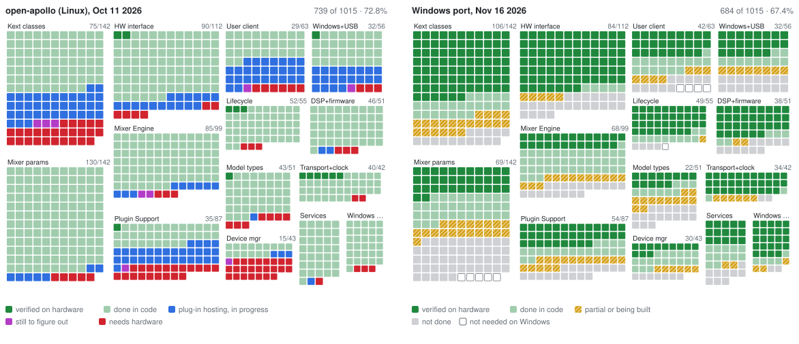

# Windows port status

Generated by `tools/status/gen-status.py` from `parity.json`. The behaviour list and open-apollo's statuses
are open-apollo's parity map (exported Oct 11 2026): every behaviour of UA's macOS kext, Mixer Engine and
Windows drivers that open-apollo reverse-engineered. Our status per behaviour comes from an audit of this
port on Nov 15 2026; `evidence` in `parity.json` says where each one lives or what is missing.

<picture>
  <source media="(prefers-color-scheme: dark)" srcset="progress-dark.svg">
  
</picture>

| | open-apollo (Oct 11) | Windows port (Nov 15) |
|---|---|---|
| Done in code or verified | 739 of 1015 (72.8%) | 626 of 1015 (61.7%) |
| Tagged verified on hardware | 14 | 468 |
| Models verified | Apollo Twin X Gen 2, Apollo x4, Apollo x8p | Apollo Twin X (Gen 1), Apollo x8p |
| UAD plug-ins live on the Apollo | 124 | 4 |

open-apollo tags only a few behaviours as verified; much of its "done" work has also run on its own units,
so the hardware row partly compares how each project records proof.

## By area

| Area | Behaviours | open-apollo done | Ours done | Ours on hardware | Ours partial | Ours not done | Not needed |
|---|---:|---:|---:|---:|---:|---:|---:|
| Kext classes | 142 | 75 | 101 | 83 | 26 | 15 | 0 |
| Mixer params | 142 | 130 | 59 | 35 | 20 | 58 | 5 |
| HW interface | 112 | 90 | 84 | 79 | 5 | 23 | 0 |
| Mixer Engine | 99 | 85 | 51 | 25 | 21 | 27 | 0 |
| Plugin Support | 87 | 35 | 48 | 34 | 20 | 19 | 0 |
| User client | 63 | 29 | 39 | 25 | 10 | 10 | 4 |
| Windows+USB | 56 | 32 | 30 | 21 | 9 | 17 | 0 |
| Lifecycle | 55 | 52 | 49 | 38 | 1 | 4 | 1 |
| DSP+firmware | 51 | 46 | 38 | 33 | 2 | 11 | 0 |
| Model types | 51 | 43 | 16 | 13 | 15 | 20 | 0 |
| Device mgr | 43 | 15 | 27 | 11 | 9 | 7 | 0 |
| Transport+clock | 42 | 40 | 32 | 32 | 8 | 2 | 0 |
| Services | 38 | 36 | 24 | 15 | 4 | 10 | 0 |
| Windows PCIe | 34 | 31 | 28 | 24 | 4 | 2 | 0 |

## Ahead of open-apollo (132)

Behaviours open-apollo marks as needing hardware, still to figure out, or plug-in hosting in progress, that this
port has done or verified.

- **Kext classes** (35): 3 transport/clock; 5 mixer; 6 manager; 7 plugin/DSP resources
- **Mixer params** (5): param 0; param 1; param 2; param 3
- **HW interface** (8): 0x0001nnnn; 0x0004nnnn; Release shared resource (pool 0); Release shared resource (pool != 0)
- **Mixer Engine** (4): Send pan (aux sends); Speaker correction / HP correction (SupportsSpeakerCorrection, ...Headp; Clock master, multi-unit order, peer-to-peer latency (ClockMasterHwId,; Plugin inserts (inputs/N/effects/N/*: 192 + 4 preamp + 8 aux entries)
- **Plugin Support** (27): Which DSP channels appear as driver (DAW) channels; Upload Bill code/data blobs (SEL127), release (100), clear cache (192);; Parameter plumbing from the plugin UI thread into DSP memory (_writeArr; Re-send parameters when the allocator moves a plugin to another DSP, de
- **User client** (18): UnregisterSharedResource; AllocatePlugin; GetPluginInfo; FreePlugin
- **Windows+USB** (14): UnregisterSharedResource; RegisterSharedResource; SetSessionFormat; AllocatePlugin
- **Lifecycle** (1): _startPowerGated 0xcb7d
- **DSP+firmware** (1): Pool totals and free (window registers + resource manager)
- **Device mgr** (17): mutex, 8 slot events, 3 timers, defaults rate 1 / src 0xC / mode 0; slot, bus grouping, DSP registration, master callbacks, notify 1; ext + AudioDevInfo arrays, master wiring; master promotion, P2P reconfig
- **Transport+clock** (1): PrepareTransport (P2P reg)
- **Services** (1): Services reads kext state through the same user client as the engine (I

## Open on our side (239)

Behaviours open-apollo has done that this port has not, or only partly.

- **Kext classes** (9): mute outputs around state changes; DSP firmware block stream; latency report and output delay comp; per-output delay comp
- **Mixer params** (71): SetBusEnable(a=bus, b=enable) (+0x20); SetOtherParam(param=b, value=c) (+0x38); a is ignored; GetMixerParam (SEL1xx, ); kPropImpedance (0xa) via ConvertImpedanceToHWCode (H)
- **HW interface** (14): W+0x40 and W+0x44 + n*0x14 (n 0-15); W+0x1A0; W+0x3C8; PrepareTransport (only when an interval was set by SetPeriodicTimerInte
- **Mixer Engine** (38): HiZ client override; Knob position / selected param (PreampInputKnobSteps, PreampGainCustomD; Direct-out monitor mix (OutputMonitorMixEnable, x8p); PGA disabled in line mode (x8p)
- **Plugin Support** (14): 64-bit key/value knobs in the kext; Text/word commands to the ARM MCU (preamp relays etc.); A mach port set via IOConnectSetNotificationPort (SEL165 SetNotificatio; FlashLED
- **User client** (8): LoadFirmware; GetSessionInfo; GetBusInfo; SetAudioClock
- **Windows+USB** (16): LoadFirmware; FlashLED; SetDriverParameter; GetDriverParameter
- **Lifecycle** (3): SetOutputMute 0x6140; DSP error vectors; SetOutputMute
- **DSP+firmware** (9): _intrCallback 0x7d9c -> _serviceMessageFIFO 0x93de; _errorCallback 0x804e -> _dispatchErrorEvent 0x9526; ResetDSP() 0x93b8; Map status word 1 to error codes (table above)
- **Model types** (27): DONE; DONE (triage 2026-10-11, was PARTIAL: mixer-engine/hardware_usb.py (pla; DONE (triage 2026-10-11, was MISSING: plan H8/O4 5daaecf/29204e7: publi; Talkback support flag
- **Device mgr** (5): client pause + 0x264/0x265; fan-out of the codes in §7; five tuning words; info, request, LED
- **Transport+clock** (9): _handleNotificationInterrupt / _notifyIntrCallback; _handleNotificationInterrupt (bits 0/1); CDeviceManager::SetAudioClock / _clockSourceChangeHandler; StartTransport / _setSampleClock (external clock)
- **Services** (13): Both Apollo PCI ids (pci1a00,1 and pci1a00,2) are matched by the kext; USB Apollo arrival; Persistent network id (nework_uid.json, UA Network ID.ini) so clients r; User-visible device name (rename)
- **Windows PCIe** (3): _allocateDSPs: count from ext_caps[15:8] (v2) or a FPGA_REV nibble tabl; SetOutputMute(m): types {0x13, 0x1C, 0x27} only (, limit 0x27); vcall o; _handleNotificationInterrupt bit map (status at 0xC008 + bank*4): bit 5

## Windows work outside the list

- **Windows sound devices** (verified): 12 playback and 11 recording devices in Windows Sound across both units; 30-minute WASAPI run with no glitches
- **ASIO driver** (verified): One unit at 128 samples, loopback bit-exact; for Ableton and Avium Measure
- **Both units as one device** (verified): x8p and Twin X as one ASIO device (60 in, 56 out) with drift correction over Thunderbolt, 0 underruns
- **Mic inputs survive a driver reload** (verified): The x8p keeps all 8 input strips running across a reload with nothing re-sent; the Twin X rebuilds its 2
- **Twin X Gen 1** (verified): Bring-up, input strips and audio on the model open-apollo lists as unverified
- **Sample rates 44.1 to 192 kHz** (done): Per unit and for the combined device
- **Speaker correction in the driver** (done): Avium Measure correction profiles run in the 1 ms engine
- **Apollo Control** (done): Six themes, both units side by side, drag-and-drop plug-ins, 4 inserts per input, REC/MON, aux buses
- **Plug-ins on the Twin X** (done): Per-unit plug-in hosting on its own DSP and licence
- **Sphere plug-ins from your own build** (done): Sphere Mic Collection and Sphere 180, which open-apollo's mapper does not match to this DLL build
- **Plug-ins after a PC restart, DAW latency** (in progress): No power cycle needed for plug-ins after a reload; true latency reported to DAWs
- **Clock, digital I/O, Twin X knob, talkback** (in progress): Clock source, ADAT/S/PDIF formats, the front-panel knob as master volume, the talkback mic
- **Sessions, start with Windows** (in progress): Save and recall everything per unit; tray app

## How it was scored

- **verified**: ran on an Apollo x8p or Twin X Gen 1 with a passing result.
- **done**: the code exists and passes the offline test suites.
- **partial**: gated, stubbed, or being built.
- **not needed on Windows**: a macOS mechanism with no function of its own in this design.
Parity on both sides counts verified plus done over all 1015 behaviours.
